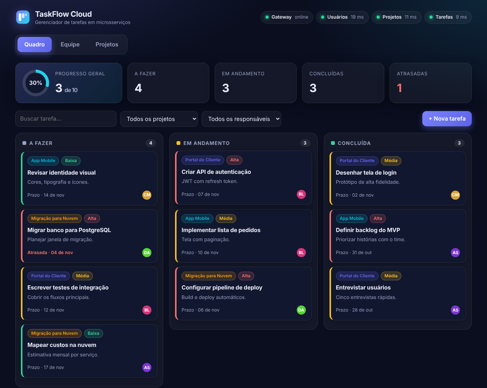
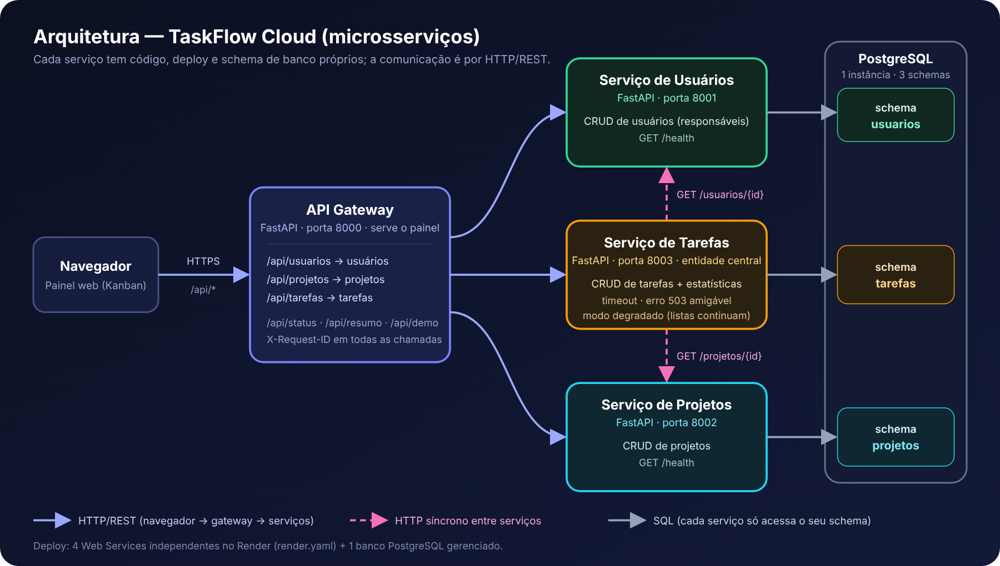

# Projeto Incremental (3ª unidade) — Módulo 2: Serviços / Microsserviços

Disciplina: Sistemas Distribuídos
Integrantes: [NOMES DO GRUPO]

- **Painel (API Gateway) em nuvem:** [COLE AQUI A URL DO sd-gateway NO RENDER]
- **Módulo 1 (versão monolítica):** [`../modulo1_nuvem`](../modulo1_nuvem)



## O que mudou em relação ao Módulo 1

O gerenciador de tarefas do Módulo 1 era uma única API. Neste módulo ele foi **decomposto em serviços independentes**, cada um com uma responsabilidade bem delimitada, e ganhou um painel web (Kanban) que conversa com tudo por um API Gateway.

| | Módulo 1 | Módulo 2 |
|---|---|---|
| Código | 1 aplicação | 4 aplicações (3 serviços + gateway) |
| Banco | 1 tabela | 1 schema por serviço (isolamento de dados) |
| Comunicação | — | HTTP/REST síncrono entre serviços |
| Falhas | a API cai inteira | a falha de um serviço é contida (modo degradado) |
| Deploy | 1 serviço no Render | 4 serviços independentes no Render |

## Arquitetura



(Versão vetorial: [`docs/arquitetura.svg`](docs/arquitetura.svg).)

| Serviço | Pasta | Porta local | Responsabilidade | Dados (schema) |
|---|---|---|---|---|
| **Usuários** | `usuarios-service/` | 8001 | Cadastro de pessoas (responsáveis) | `usuarios` |
| **Projetos** | `projetos-service/` | 8002 | Cadastro de projetos que agrupam tarefas | `projetos` |
| **Tarefas** | `tarefas-service/` | 8003 | Entidade central: CRUD de tarefas, estatísticas | `tarefas` |
| **Gateway + painel** | `gateway/` | 8000 | Ponto de entrada único, proxy, status e painel web | — |

Princípios aplicados:

- **Código e deploy independentes.** Cada pasta é uma aplicação FastAPI com seu `requirements.txt` e seu próprio serviço no Render.
- **Banco por serviço.** Cada serviço só acessa o seu *schema*. No Render usamos um único PostgreSQL (o plano gratuito permite um por conta) com 3 schemas; localmente cada serviço usa o seu arquivo SQLite. Não há chave estrangeira entre serviços: a tarefa guarda apenas `responsavel_id` e `projeto_id`.
- **Comunicação síncrona por HTTP.** O serviço de **Tarefas** consulta os serviços de **Usuários** e **Projetos** (`GET /usuarios/{id}`, `GET /projetos/{id}`, `GET /usuarios`, `GET /projetos`). O gateway encaminha as chamadas do navegador (`/api/usuarios`, `/api/projetos`, `/api/tarefas`).
- **Rastreabilidade.** Cada requisição recebe um `X-Request-ID`, repassado entre os serviços e registrado nos logs de todos eles.

## Tratamento de falhas (serviço dependente indisponível)

Toda chamada entre serviços usa **timeout** (`REQUEST_TIMEOUT`, padrão 8 s). O comportamento quando um serviço está fora do ar depende da operação:

| Operação | Usuários/Projetos fora do ar |
|---|---|
| Criar/editar tarefa **com** `responsavel_id` ou `projeto_id` | **HTTP 503** com mensagem amigável (`"O serviço de usuários está indisponível no momento. Tente novamente em instantes."`) |
| Criar/editar tarefa **sem** essas referências | Funciona normalmente |
| Listar/consultar tarefas | **HTTP 200** em *modo degradado*: a tarefa vem completa, e o responsável/projeto aparece como `{"id": 3, "indisponivel": true}`; o cabeçalho `X-Servicos-Degradados` indica o que falhou |
| Referência a um usuário/projeto apagado | `{"id": 3, "removido": true}` |
| Referência a um id que não existe (ao criar) | **HTTP 422** |

O painel mostra um aviso amarelo de "modo degradado", exibe `?` no lugar do avatar e se recupera sozinho quando o serviço volta. Os indicadores do topo mostram, em tempo real, o estado e a latência de cada serviço.

## Como executar localmente

Requisitos: Python 3.10+ e Linux/macOS (bash).

```bash
cd ATV3/modulo2_microsservicos
./run_local.sh
```

O script cria um ambiente virtual, instala as dependências e sobe os 4 serviços. Depois abra:

- Painel: <http://localhost:8000> (clique em **Carregar dados de demonstração**)
- Documentação interativa de cada serviço: `http://localhost:8001/docs`, `:8002/docs` e `:8003/docs`

## Como testar a comunicação entre os serviços

**1. Teste automatizado** (cria dados, confere a integração e limpa tudo; 17 verificações):

```bash
python3 scripts/testar_comunicacao.py                          # local
python3 scripts/testar_comunicacao.py https://URL-DO-GATEWAY   # nuvem
```

**2. Teste manual: tarefas consultando outros serviços**

```bash
G=http://localhost:8000   # ou a URL do gateway no Render
curl -X POST $G/api/usuarios -H "Content-Type: application/json" -d '{"nome":"Maria","email":"maria@exemplo.com","cargo":"Dev"}'
curl -X POST $G/api/projetos -H "Content-Type: application/json" -d '{"nome":"Projeto X"}'
curl -X POST $G/api/tarefas  -H "Content-Type: application/json" -d '{"titulo":"Testar","responsavel_id":1,"projeto_id":1}'
```

A resposta da última chamada traz o **nome** do responsável e do projeto: esses dados vieram, por HTTP, dos outros dois serviços.

**3. Teste manual: serviço dependente indisponível**

1. Derrube o serviço de usuários. Local: `pkill -f "uvicorn main:app --port 8001"`. No Render: abra o serviço `sd-usuarios` → **Suspend**.
2. Tente criar uma tarefa com responsável:
   ```bash
   curl -i -X POST $G/api/tarefas -H "Content-Type: application/json" -d '{"titulo":"Falha","responsavel_id":1}'
   ```
   Resultado esperado: `HTTP 503` com a mensagem amigável.
3. Liste as tarefas: `curl -i $G/api/tarefas`. Resultado esperado: `HTTP 200`, com `X-Servicos-Degradados: usuarios` e os responsáveis marcados como `indisponivel`.
4. Suba o serviço de novo e repita: tudo volta ao normal.

## Deploy no Render

O arquivo [`render.yaml`](../../render.yaml) (na raiz do repositório) descreve os 4 Web Services. O banco gratuito do Render é um só por conta, então **reaproveitamos o PostgreSQL do Módulo 1**; cada serviço cria o seu próprio schema.

1. No Render: **New → Blueprint**, escolha este repositório e confirme os 4 serviços (`sd-usuarios`, `sd-projetos`, `sd-tarefas`, `sd-gateway`).
2. Quando o Render pedir os valores:
   - `DATABASE_URL`: a *Internal Database URL* do PostgreSQL (a mesma nos 3 serviços de dados);
   - `USUARIOS_URL`, `PROJETOS_URL`, `TAREFAS_URL`: as URLs públicas dos serviços, no formato `https://sd-usuarios.onrender.com`. Se o Render acrescentar um sufixo ao nome, corrija essas variáveis depois, no painel de cada serviço (aba *Environment*).
3. Aguarde os deploys. Abra a URL do `sd-gateway`: os quatro indicadores do topo devem ficar verdes. Depois clique em **Carregar dados de demonstração**.

Observações sobre o plano gratuito:

- Cada serviço entra em repouso após 15 minutos sem acessos. Na primeira abertura, o painel pode levar cerca de 1 minuto para acordar os três serviços; por isso `REQUEST_TIMEOUT` é 25 s no Render.
- O PostgreSQL gratuito expira 30 dias após a criação.

## Estrutura do repositório

```
render.yaml                     Blueprint do Render (4 serviços)
ATV3/modulo2_microsservicos/
├── README.md
├── run_local.sh                sobe tudo localmente
├── docs/                       diagrama de arquitetura e captura do painel
├── scripts/testar_comunicacao.py
├── usuarios-service/           main.py + requirements.txt
├── projetos-service/           main.py + requirements.txt
├── tarefas-service/            main.py + requirements.txt
└── gateway/                    main.py + requirements.txt + static/index.html (painel)
```

## Preparação para os próximos módulos

- **Containers (Módulo 3):** cada serviço já é autônomo e configurado por variáveis de ambiente, então basta um `Dockerfile` por pasta e um `docker-compose.yml`.
- **Mensageria (Módulo 4):** o serviço de tarefas já registra nos logs os eventos de domínio (`tarefa.criada`, `tarefa.status_alterado`, `tarefa.removida`), que passarão a ser publicados em um broker.
