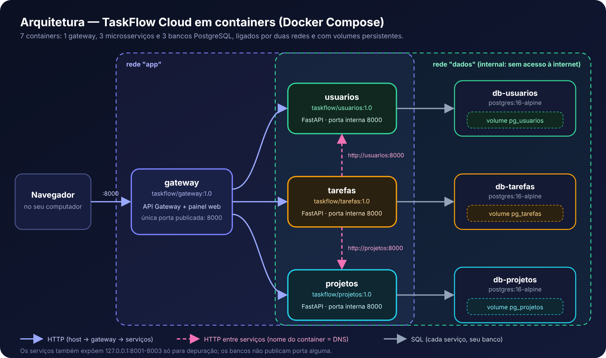

# Projeto Incremental (3ª unidade) — Módulo 3: Containers

Disciplina: Sistemas Distribuídos
Integrantes: Manoel Luiz de Medeiros Neto

- **Vídeo de demonstração (YouTube, não listado):** https://youtu.be/F95lwPVkqYM
- **Módulo anterior (microsserviços):** [`../modulo2_microsservicos`](../modulo2_microsservicos)

Neste módulo, os microsserviços do Módulo 2 foram **empacotados em imagens Docker** e todo o sistema passou a ser executado com **um único comando**, por meio do Docker Compose: 3 microsserviços, o gateway com o painel web e **3 bancos PostgreSQL** (um por serviço), com volumes persistentes. O código dos serviços **não mudou**: só a forma de empacotar e executar.



(Versão vetorial: [`docs/arquitetura-containers.svg`](docs/arquitetura-containers.svg).)

## O que há neste módulo

| Arquivo | Função |
|---|---|
| [`docker-compose.yml`](docker-compose.yml) | Orquestra os 7 containers, as 2 redes e os 3 volumes |
| [`.env.example`](.env.example) | Modelo para trocar usuário/senha dos bancos (opcional) |
| `../modulo2_microsservicos/<serviço>/Dockerfile` | Um Dockerfile por serviço (usuarios, projetos, tarefas e gateway) |
| `../modulo2_microsservicos/<serviço>/.dockerignore` | Mantém lixo (cache, bancos locais, `.env`) fora da imagem |
| [`scripts/testar_persistencia.sh`](scripts/testar_persistencia.sh) | Teste automatizado de `down`/`up` mantendo os dados |

Os Dockerfiles ficam ao lado do código de cada serviço, que é o lugar convencional; o Compose os encontra pelo `build:`.

## Pré-requisitos

- **Docker Engine com o plugin Compose v2.** Guia oficial: <https://docs.docker.com/engine/install/>. Em Ubuntu e derivados (como o Zorin OS), use o repositório oficial do Docker, informando o nome da base Ubuntu (por exemplo `noble`, de `UBUNTU_CODENAME` em `/etc/os-release`):
  ```bash
  sudo apt install -y ca-certificates curl
  sudo install -m 0755 -d /etc/apt/keyrings
  sudo curl -fsSL https://download.docker.com/linux/ubuntu/gpg -o /etc/apt/keyrings/docker.asc
  sudo chmod a+r /etc/apt/keyrings/docker.asc
  echo "deb [arch=$(dpkg --print-architecture) signed-by=/etc/apt/keyrings/docker.asc] https://download.docker.com/linux/ubuntu noble stable" | sudo tee /etc/apt/sources.list.d/docker.list > /dev/null
  sudo apt update
  sudo apt install -y docker-ce docker-ce-cli containerd.io docker-buildx-plugin docker-compose-plugin
  sudo usermod -aG docker $USER     # para rodar sem sudo; abra um novo terminal depois
  ```
  (O script `get.docker.com` pode identificar errado distribuições derivadas, como o Zorin; por isso o repositório é adicionado manualmente.)
- Confira com `docker --version`, `docker compose version` e `docker run hello-world`.
- `curl` e `python3` (apenas para os scripts de teste).

## Como executar

```bash
cd ATV3/modulo3_containers
docker compose up -d --build --wait
```

- `--build` constrói as imagens (a primeira vez leva alguns minutos para baixar as imagens base).
- `--wait` só retorna quando todos os containers estiverem saudáveis (healthchecks).

Depois abra o painel em <http://localhost:8000> e clique em **Carregar dados de demonstração**. Para acompanhar:

```bash
docker compose ps                    # estado e saúde de cada container
docker compose logs -f tarefas       # logs de um serviço (veja o X-Request-ID e os eventos)
docker images "taskflow/*"           # as 4 imagens construídas
```

Para trocar as credenciais dos bancos, copie `.env.example` para `.env` e edite (use apenas letras e números na senha, pois ela entra na URL de conexão).

### Encerrar

```bash
docker compose down        # remove containers e redes; os DADOS continuam nos volumes
docker compose down -v     # remove também os volumes (apaga os dados)
```

## O que cada Dockerfile faz (boas práticas)

Os quatro Dockerfiles seguem o mesmo modelo:

1. **Multi-stage build.** O estágio `builder` cria um virtualenv e instala as dependências; o estágio final copia só o virtualenv e o `main.py`. Ferramentas de build e cache do pip não vão para a imagem final.
2. **Imagem base enxuta:** `python:3.13-slim`. Foi preferida à variante `alpine` porque o driver `psycopg[binary]` tem pacotes pré-compilados para glibc (Debian) e evita compilar código nativo.
3. **Usuário sem privilégios** (`USER app`, UID 10001): o processo não roda como root dentro do container.
4. **Camadas bem ordenadas:** o `requirements.txt` é copiado e instalado antes do código, então alterar o `main.py` reaproveita o cache das dependências.
5. **`HEALTHCHECK`** (usando apenas o Python da imagem, sem instalar `curl`) consultando `/health`; o Compose usa esse resultado para ordenar a inicialização.
6. **Configuração por variáveis de ambiente** (`DATABASE_URL`, `USUARIOS_URL`, ...), sem segredos dentro da imagem. A mesma imagem funciona em qualquer ambiente.
7. **`.dockerignore`** para não enviar arquivos desnecessários ao contexto de build.

## O que o `docker-compose.yml` faz

- **Um banco por serviço** (`db-usuarios`, `db-projetos`, `db-tarefas`, todos `postgres:16-alpine`): cada microsserviço é dono dos seus dados, sem acesso aos dos outros.
- **Volumes nomeados** (`pg_usuarios`, `pg_projetos`, `pg_tarefas`) montados em `/var/lib/postgresql/data`: os dados sobrevivem à remoção dos containers.
- **Duas redes:**
  - `app`: gateway e serviços;
  - `dados`: serviços e bancos, marcada como `internal: true` (sem acesso à internet). O gateway **não** está nela, então não enxerga os bancos.
- **Descoberta de serviços por DNS:** os containers se acham pelo nome (`http://usuarios:8000`, `db-tarefas:5432`).
- **Healthchecks e `depends_on: condition: service_healthy`:** os serviços só sobem depois do banco estar aceitando conexões; o gateway só sobe depois dos serviços.
- **Portas:** só o gateway é publicado para a rede do computador (`8000`). Os serviços ficam em `127.0.0.1:8001-8003` apenas para depuração (`/docs` de cada API), e os bancos não publicam porta alguma.
- **`restart: unless-stopped`:** containers que caírem são reiniciados.
- **Variáveis com valores padrão:** `docker compose up` funciona sem `.env`; para outro usuário/senha, use o `.env`.

## Teste de persistência dos dados

**Automático** (sobe, popula, derruba, sobe de novo e compara as contagens):

```bash
./scripts/testar_persistencia.sh
```

**Manual**, passo a passo:

```bash
docker compose up -d --build --wait
curl -X POST http://localhost:8000/api/demo          # cria usuários, projetos e tarefas
curl http://localhost:8000/api/resumo                # anote: usuários 4, projetos 3, tarefas 10

docker compose down                                  # containers e redes removidos
docker volume ls | grep taskflow                     # os 3 volumes continuam lá

docker compose up -d --wait                          # containers NOVOS, mesmos volumes
curl http://localhost:8000/api/resumo                # os mesmos números: os dados persistiram
```

Para provar o contrário (sem volume, sem dados): `docker compose down -v` e `docker compose up -d --wait` deixam o sistema vazio de novo.

## Teste de comunicação e de falha entre containers

O mesmo teste de integração do Módulo 2 funciona contra os containers:

```bash
python3 ../modulo2_microsservicos/scripts/testar_comunicacao.py http://localhost:8000
```

Teste de falha (o isolamento de containers em ação):

```bash
docker compose stop usuarios                         # derruba só o container de usuários
curl -i -X POST http://localhost:8000/api/tarefas -H "Content-Type: application/json" \
     -d '{"titulo":"Falha","responsavel_id":1}'      # HTTP 503 com mensagem amigável
curl -i http://localhost:8000/api/tarefas            # HTTP 200, responsáveis "indisponivel" (modo degradado)
docker compose start usuarios                        # volta ao normal
```

## Comparação: deploy direto (Módulos 1 e 2) × containers (Módulo 3)

| Aspecto | Deploy direto no Render (M1/M2) | Containers com Docker Compose (M3) |
|---|---|---|
| Como roda | A plataforma lê o código-fonte, instala dependências e executa | Uma **imagem** pronta (código + dependências + Python) é executada |
| Ambiente | Definido pela plataforma (versão do Python, SO) | Definido por nós no Dockerfile; **idêntico** em qualquer máquina |
| Subir o sistema | Criar serviços e banco no painel, preencher variáveis | `docker compose up`, um comando, tudo declarado em arquivos |
| Bancos | Limite do plano gratuito: 1 PostgreSQL, então 3 *schemas* | 3 containers de banco, um por serviço (isolamento real) |
| Persistência | Gerenciada pela plataforma (e expira em 30 dias no plano gratuito) | Volumes Docker sob nosso controle |
| Rede | Serviços se falam por URL pública (HTTPS) | Rede privada com DNS interno; só o gateway é exposto |
| Código da aplicação | `main.py` | **O mesmo `main.py`**: só mudam as variáveis de ambiente |

**O que ficou mais fácil:** reproduzir o ambiente (acabou o "funciona na minha máquina"), executar o sistema completo localmente com um comando, isolar cada serviço (e cada banco), testar falhas parando um container e levar a mesma imagem para qualquer nuvem.

**O que ficou mais difícil:** aprender e manter Dockerfile e Compose; o primeiro build é demorado e consome disco; é preciso entender redes, volumes e healthchecks; e há mais peças para depurar (por exemplo, o serviço subir antes do banco), o que motivou os healthchecks e o `depends_on`.

## Justificativas técnicas

- **Docker Compose** é suficiente para orquestrar 7 containers numa máquina e documenta toda a infraestrutura em um arquivo versionado. Kubernetes seria exagero neste porte (é uma extensão opcional).
- **Banco por serviço** reforça a independência dos microsserviços: um serviço não consegue ler nem corromper os dados de outro, e cada banco pode evoluir separadamente.
- **Rede `dados` interna** aplica o princípio do menor privilégio: bancos fora da internet e longe do gateway.
- **Volumes nomeados** separam o ciclo de vida dos dados do ciclo de vida dos containers, que são descartáveis.
- **Healthchecks** trocam "esperar alguns segundos e torcer" por uma condição verificável de que o banco ou o serviço está pronto.
- **Imagens `slim`, multi-stage e usuário não-root** reduzem tamanho e superfície de ataque.

## (Opcional) Publicar as imagens em nuvem

O Render também aceita implantar a partir de um Dockerfile: ao criar o *Web Service*, escolha o ambiente **Docker**, informe a pasta do serviço em *Root Directory* e use as mesmas variáveis de ambiente do Módulo 2. Esta etapa opcional não foi automatizada neste repositório; o `render.yaml` da raiz continua descrevendo o deploy do Módulo 2 (runtime Python).

## Preparação para o próximo módulo

Feito em [`../modulo4_mensageria`](../modulo4_mensageria): o RabbitMQ entrou como mais um container na rede `app`, o serviço de tarefas passou a publicar eventos (`tarefa.criada`, `tarefa.concluida`...) e um novo serviço de notificações os consome.
