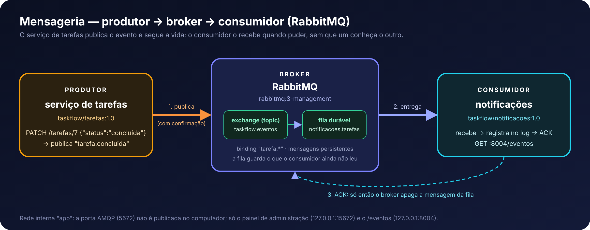
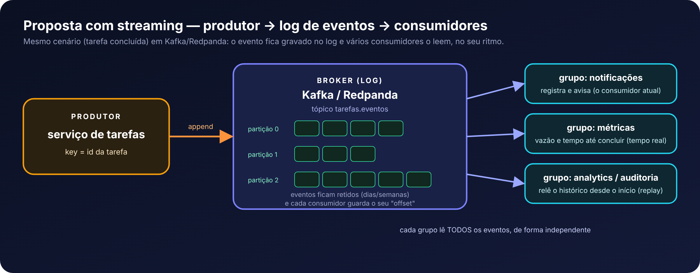

# Projeto Incremental (3ª unidade) — Módulo 4: Mensageria e Streaming de Eventos

Disciplina: Sistemas Distribuídos
Integrantes: Manoel Luiz de Medeiros Neto

- **Vídeo de demonstração (YouTube, não listado):** [COLE AQUI O LINK]
- **Módulo anterior (containers):** [`../modulo3_containers`](../modulo3_containers)

Neste módulo, o sistema ganhou **comunicação assíncrona por mensagens**. Quando uma tarefa é criada, muda de estado ou é **concluída**, o serviço de tarefas publica um **evento** no **RabbitMQ**, e um novo serviço, o de **notificações**, o consome e confirma o recebimento. Quem publica não conhece nem espera quem consome.



(Versão vetorial: [`docs/arquitetura-mensageria.svg`](docs/arquitetura-mensageria.svg).)

## O que há neste módulo

| Item | Função |
|---|---|
| [`docker-compose.yml`](docker-compose.yml) | Os 7 containers do Módulo 3 + **RabbitMQ** + **consumidor** (9 containers) |
| [`notificacoes-service/`](notificacoes-service) | **Consumidor**: FastAPI + `pika`; Dockerfile e `.dockerignore` próprios |
| [`../modulo2_microsservicos/tarefas-service/main.py`](../modulo2_microsservicos/tarefas-service/main.py) | **Produtor**: função `publicar_evento()` chamada nas operações de tarefas |
| [`scripts/testar_mensageria.py`](scripts/testar_mensageria.py) | Teste automatizado do fluxo (e de resiliência, com `--resiliencia`) |
| [`docs/`](docs) | Diagramas de mensageria (implementada) e de streaming (proposta) |

## Como executar

Requisitos: os mesmos do Módulo 3 (Docker + Compose v2).

```bash
cd ATV3/modulo4_mensageria
docker compose up -d --build --wait
```

Se o Módulo 3 estiver no ar, o comando apenas troca o serviço de tarefas e acrescenta o RabbitMQ e o consumidor; os dados nos volumes continuam. Depois de subir:

- Painel do sistema: <http://localhost:8000>
- **Painel do RabbitMQ:** <http://localhost:15672> (usuário `taskflow`, senha `taskflow_mq`): aba *Queues* mostra a fila `notificacoes.tarefas`.
- Eventos recebidos pelo consumidor: <http://localhost:8004/eventos>

### Ver o fluxo funcionando

Em um terminal, acompanhe os dois lados:

```bash
docker compose logs -f tarefas notificacoes
```

Em outro, conclua uma tarefa (ou arraste um cartão para "Concluída" no painel):

```bash
curl -s -X POST http://localhost:8000/api/tarefas -H "Content-Type: application/json" \
     -d '{"titulo":"Entregar o Modulo 4","prioridade":"alta"}'
curl -s -X PATCH http://localhost:8000/api/tarefas/1 -H "Content-Type: application/json" \
     -d '{"status":"concluida"}'
```

Nos logs aparecem, na ordem: `PUBLICADO tarefa.concluida` (produtor) e `NOTIFICAÇÃO: tarefa #1 "…" foi CONCLUÍDA` (consumidor), com o mesmo identificador de mensagem. Esse trecho é o log pedido como evidência.

### Teste automatizado

```bash
python3 scripts/testar_mensageria.py                 # fluxo: criada → status_alterado → concluída → removida
python3 scripts/testar_mensageria.py --resiliencia   # + consumidor fora do ar + broker fora do ar
```

## Eventos publicados

Exchange `taskflow.eventos` (tipo **topic**, durável). A *routing key* é o nome do evento:

| Evento | Quando |
|---|---|
| `tarefa.criada` | tarefa criada |
| `tarefa.status_alterado` | o status mudou (corpo traz `de` e `para`) |
| **`tarefa.concluida`** | o status passou a `concluida` (**o evento do domínio pedido no módulo**) |
| `tarefa.removida` | tarefa apagada |

Exemplo de mensagem (JSON):

```json
{
  "id": "c5a8a82d-daea-4c5d-a42b-f3b8a99b597d",
  "evento": "tarefa.concluida",
  "ocorrido_em": "2026-11-16T16:12:25+00:00",
  "request_id": "0f7b682c",
  "dados": {"id": 1, "titulo": "Entregar o Modulo 4", "status": "concluida",
            "prioridade": "alta", "responsavel_id": null, "projeto_id": null}
}
```

O `request_id` é o mesmo `X-Request-ID` das chamadas HTTP, então dá para acompanhar uma ação do clique no painel até a notificação.

## Como produtor e consumidor foram feitos

**Produtor** (no serviço de tarefas):

- Conexão com `pika` (`BlockingConnection`), criada sob demanda e reaproveitada.
- Mensagens **persistentes** (`delivery_mode=2`) e **confirmação do broker** (*publisher confirms*): o produtor só considera publicado depois que o RabbitMQ confirma.
- **O broker fora do ar não derruba a API.** Se a publicação falhar, a operação (criar/concluir a tarefa) continua normalmente, o evento é registrado em log e o produtor espera 10 s antes de tentar de novo, para não atrasar cada requisição.
- **É opcional:** sem a variável `RABBITMQ_URL`, nada muda. Por isso o Módulo 2 no Render continua funcionando com o mesmo código.

**Consumidor** (`notificacoes-service`):

- **Fila durável** `notificacoes.tarefas`, ligada ao exchange com a chave `tarefa.*`: se o consumidor estiver fora do ar, as mensagens esperam na fila.
- **ACK manual:** a mensagem só sai da fila depois de processada. Se o consumidor cair no meio, o RabbitMQ a reentrega.
- **Idempotência:** o `id` da mensagem é guardado, e uma entrega duplicada (possível no modelo "pelo menos uma vez") é ignorada.
- Mensagem inválida é descartada com `nack` sem reenfileirar, para não travar a fila.
- Se o RabbitMQ ainda não está pronto ou cai, o consumidor tenta reconectar sozinho a cada 3 s.

**Compose:** imagem oficial `rabbitmq:3-management`, volume para os dados, healthcheck (`rabbitmq-diagnostics ping`) e `depends_on: service_healthy`. A porta AMQP (5672) **não é publicada**: só os containers da rede interna conversam com o broker. As credenciais têm valor padrão e podem ser trocadas em um `.env` (veja `.env.example`).

## Comparação: mensageria × streaming de eventos

Cenário do grupo: **"tarefa concluída"**.



### Como o cenário seria modelado com streaming (Kafka ou Redpanda)

O serviço de tarefas passaria a escrever cada evento em um **tópico** `tarefas.eventos` (com a chave igual ao id da tarefa, para manter a ordem dos eventos de uma mesma tarefa na mesma partição). O tópico é um **log**: as mensagens não somem quando são lidas, ficam retidas por um período (ou para sempre) e **cada grupo de consumidores guarda o seu próprio *offset***, isto é, até onde já leu.

O que mudaria em relação ao RabbitMQ implementado:

| Aspecto | Mensageria (RabbitMQ, implementado) | Streaming (Kafka/Redpanda, proposto) |
|---|---|---|
| Modelo | Fila: o broker **entrega** e, após o ACK, **apaga** a mensagem | Log: o evento **fica gravado**; o consumidor **puxa** e controla o seu *offset* |
| Vários consumidores | Cada interessado precisa da sua própria fila (e o broker faz a cópia) | Cada **grupo** lê todo o log de forma independente, sem custo extra de cópia |
| Reler o passado (*replay*) | Não: o que foi consumido sumiu | Sim: basta voltar o *offset* (reprocessar, corrigir um bug, criar um consumidor novo com todo o histórico) |
| Ordem | Por fila (e quebra com vários consumidores concorrentes) | Garantida **por partição** (aqui, por tarefa) |
| Escala | Boa; roteamento flexível (exchanges, bindings) | Muito alta vazão, escala por **partições** |
| Complexidade operacional | Baixa | Maior (partições, replicação, retenção, *offsets*) |

**Quem seriam os consumidores?** Além do serviço de notificações (que já existe), um serviço de **métricas** (vazão e tempo até concluir uma tarefa, em tempo real), um de **analytics/auditoria** (relê o histórico para relatórios e para reconstruir o estado) e, no futuro, um de **busca** ou de **e-mails**, todos lendo o mesmo tópico sem que o produtor saiba que existem.

### Quando streaming se justificaria mais do que a mensageria

- Quando **vários sistemas** precisam consumir os **mesmos** eventos, cada um no seu ritmo.
- Quando for preciso **reprocessar o histórico**: reconstruir um banco, criar uma nova visão dos dados ou corrigir um consumidor com defeito.
- Quando o volume de eventos for **muito alto** e contínuo (telemetria, cliques, *logs*, milhões de eventos por segundo).
- Quando a **ordem por entidade** e a **auditoria** do que aconteceu forem requisitos (o log é a fonte da verdade, base de *event sourcing*).
- Quando for preciso **processar fluxos em tempo real** (janelas, agregações, detecção de padrões).

### Por que a mensageria foi suficiente aqui

Neste projeto há um evento e **um** consumidor, em baixo volume, e o que importa é a **entrega confiável de cada notificação uma vez**, sem guardar histórico. Uma fila com ACK atende isso com pouca infraestrutura (um container), roteamento simples por chave e administração visual pronta. Kafka/Redpanda traria partições, retenção e *offsets* para resolver problemas que o cenário ainda não tem. Se o sistema crescesse para vários consumidores independentes e necessidade de *replay*, a migração do produtor para um tópico seria o passo natural, e o formato do evento (JSON com `id`, `evento`, `dados`) já foi pensado para isso.

## Justificativas técnicas

- **RabbitMQ**: é o broker mais direto para o padrão produtor/consumidor, tem imagem oficial com painel de administração e `pika` é a biblioteca cliente padrão em Python.
- **Exchange *topic*** em vez de fila direta: o produtor publica por tipo de evento e novos consumidores podem se ligar à mesma exchange com outras chaves, sem mudar o produtor.
- **Fila durável + mensagens persistentes + ACK manual + *publisher confirms***: nenhuma mensagem é perdida se o consumidor ou o broker reiniciarem.
- **Publicação tolerante a falhas**: o broker é uma dependência **opcional** do caminho de escrita; a API não pode ficar indisponível por causa de uma notificação. O custo é que, com o broker fora do ar, o evento é perdido (fica só em log). A solução completa seria o padrão *outbox* (gravar o evento no banco na mesma transação e publicá-lo depois), registrado aqui como evolução possível.
- **Consumidor idempotente**: o RabbitMQ garante entrega "pelo menos uma vez", então duplicatas precisam ser inofensivas.

## Estrutura

```
ATV3/modulo4_mensageria/
├── README.md
├── docker-compose.yml          9 containers (M3 + rabbitmq + notificacoes)
├── .env.example
├── docs/                       diagramas (mensageria e streaming), .svg e .png
├── scripts/testar_mensageria.py
└── notificacoes-service/       consumidor: main.py, Dockerfile, requirements.txt
```
